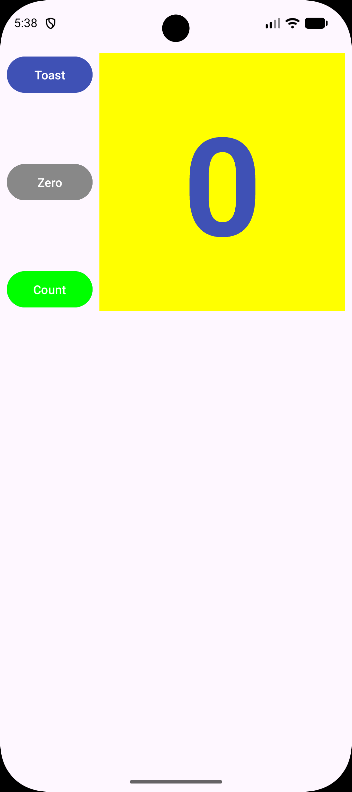
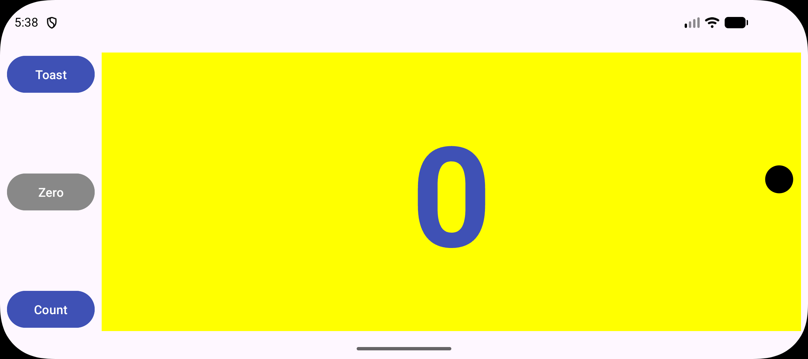

# HelloConstraint

Aplikacija s števcem, postavljena s ConstraintLayout, v Android Studiu

## Funkcionalnosti

- **TextView** `show_count` z rumenim ozadjem, ki prikazuje trenutno vrednost števca
- **Button** »Toast«, ki prikaže Toast sporočilo
- **Button** »Count«, ki poveča števec in spremeni svojo barvo glede na to, ali je vrednost soda (zelena) ali liha (rdeča)
- **Button** »Zero«, ki je na začetku siv, ob štetju postane roza (aktiven), ob kliku pa števec ponastavi na 0 in se vrne na sivo
- Vsi trije gumbi so levo od števca in navpično razporejeni med njegovim zgornjim in spodnjim robom
- Ločene postavitve za **pokončno**, **ležečo** (`layout-land`) in **tablico** (`layout-xlarge`)

## Posnetki zaslona

  
